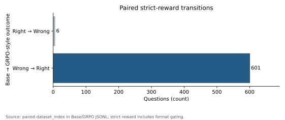
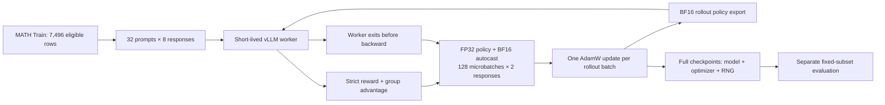

# Single-GPU GRPO-Style Post-Training for Mathematical Reasoning

[中文说明](README_CN.md) · [Algorithm](docs/algorithm.md) · [Evaluation](docs/evaluation.md) · [Reproduce](docs/reproducibility.md)

A Stanford CS336 Spring 2025 A5 extension studying mathematical post-training on
Qwen2.5-Math-1.5B, using single-GPU PyTorch training and serialized vLLM rollouts.
Reported hardware: one AMD MI300X; this local packaging run did not remeasure GPU behavior.

## Highlights

- Group-standardized, response-length-normalized **on-policy REINFORCE with baseline**.
- FP32 training parameters, BF16 inference exports, gradient accumulation, and checkpoint/resume code.
- Preserved response-level evidence, format-bias analysis, data-isolation checks, and CPU verification.
- **CS336 A5 core implementation + selected experiments**. PPO/GRPO clipping was not enabled in this run.

## Key results

| Metric on the same 1024 questions | Base | GRPO-style Step 105 |
|---|---:|---:|
| Strict R1-Zero reward (format gated) | 148/1024 (14.45%) | 743/1024 (72.56%) |
| Format compliance | 39.94% | 90.82% |
| Supplementary automatic extraction estimate — **not official accuracy** | 42.68% | 72.66% |

Strict reward difference: **+58.11 percentage points**. This includes format learning;
it is **not a measured +58.11pp gain in pure mathematical reasoning**.
The supplementary estimate difference is +29.98pp and remains a post-hoc diagnostic.

Training logs contain **109 optimizer updates**. The latest archived complete-checkpoint
pointer and evaluated model label are **Step 105**. Through that step, the recorded run
sampled **26,880 responses**.


The curve is changing-batch rollout reward, not validation accuracy. Thin line: per-step;
thick line: trailing mean of up to 10 steps; dashed line: evaluated checkpoint label.

 

 

All plots are generated from [preserved records](results/records/) and
[training metrics](results/metrics/train_metrics.jsonl), with [source hashes](results/figures/figure_sources.json).

## System architecture



Execution is serialized; the training model/optimizer remain resident during rollout.
The provided local Step 105 archive contains **model files only**, not a full resume checkpoint.

## What is optimized?

For prompt group g, use the group-relative advantage and masked response objective:

$$A_{g,i}=\frac{r_{g,i}-\bar r_g}{s_g+10^{-6}},\qquad
L=-\frac1B\sum_i A_i\frac{\sum_t m_{i,t}\log\pi_\theta(y_{i,t}\mid x_i,y_{i,<t})}{\sum_t m_{i,t}}.$$

The run uses B=256, group size 8, 32 prompts, 128 microbatches of 2 responses,
and one optimizer update per rollout batch. No clipped importance ratio or KL penalty
is used. [Detailed Chinese derivation and source mapping](docs/algorithm.md).

## Quick start: CPU evidence reproduction

```sh
python scripts/project.py check-config
python scripts/project.py doctor
python scripts/project.py report --output .local/reports/recomputed-001
python scripts/project.py figures --output .local/figures/recomputed-001
python -m pytest -q --basetemp=.local/pytest-temp -p no:cacheprovider
```

Use Python 3.12. Reporting uses the standard library; plots need Matplotlib; core
tests need an existing CPU PyTorch installation and pytest. Data isolation checks
add PyArrow. See [dependencies and exact commands](docs/reproducibility.md).
No command above loads a pretrained model or probes a GPU.

## Evaluation and error analysis

The archived protocol uses one completion per question, the same R1-Zero prompt,
and a shared decoding implementation. Historical defaults are greedy decoding and a
1,024-token generation budget; actual historical CLI/model hashes were not saved.
New evaluation uses a fresh directory, a shared explicit tokenizer, raw token IDs,
stop metadata, and model/protocol hashes; existing results are never reused.

Paired strict transitions: **601 wrong→right**, **6 right→wrong**.
Of the gains, 427 had a format-invalid Base answer.
See [five real examples](results/examples/CASES_CN.md), [evaluation protocol](docs/evaluation.md),
and [中文误差分析](docs/evaluation_cn.md). Final-answer success does not certify the full reasoning trace.

## Reproducibility and limitations

- No exact/whitespace-normalized Train overlap in this evaluation subset; full Test has one whitespace-normalized duplicate.
- Six questions appeared in earlier project development evaluations: this is not an entirely unseen confirmation set.
- Current archive hashes do **not** prove historical evaluation weight identity.
- Historical token counts/EOS/finish reasons are unavailable; missing answer tags are not a measured truncation rate.
- The local archive lacks optimizer/RNG state; exact training resume requires a separate complete checkpoint.
- New training/evaluation GPU paths have not been executed in this packaging run.

See [limitations](docs/limitations.md), [provenance](docs/provenance.md),
[CPU validation record](results/metrics/validation.json), and [release checklist](docs/GITHUB_PLAN.md).

## Acknowledgements

Stanford CS336 Spring 2025 A5, Qwen, PyTorch, Transformers, vLLM, and the mathematical
grader contributors. Course scaffolding, the third-party grader, and pretrained
weights are not claimed as original work. See [NOTICE](NOTICE.md) and
[license notes](LICENSE_NOTES.md). This is a single-turn mathematical RL project,
not a tool-using Agent RL system or a complete A5 submission.
