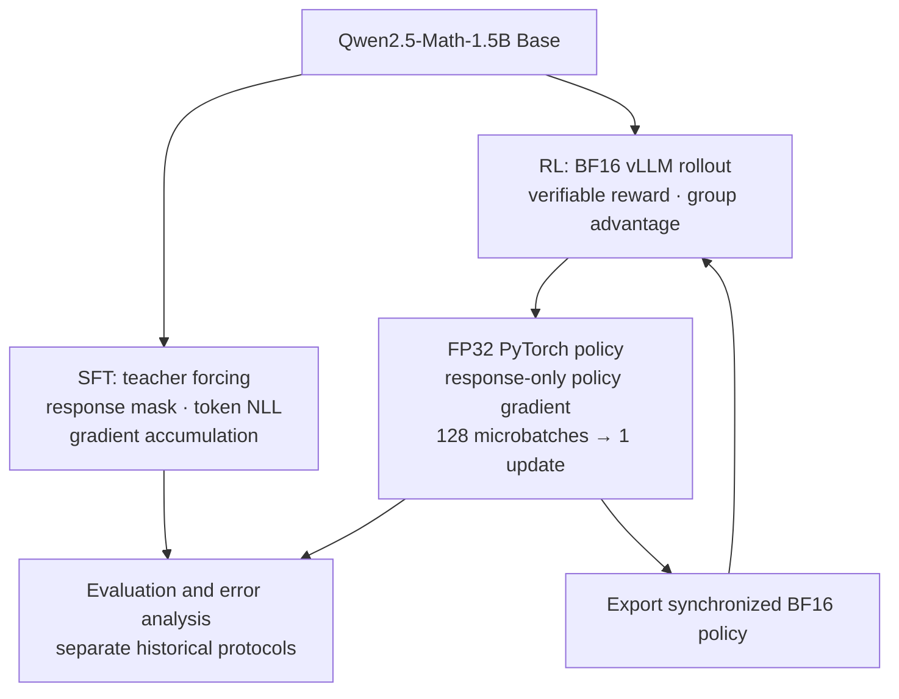
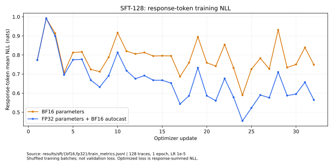
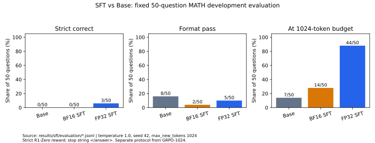

# Single-GPU LLM Post-Training: SFT and Group-Relative Reinforcement Learning

**Teacher-forced SFT and online mathematical RL for Qwen2.5-Math-1.5B, with a single-AMD-MI300X PyTorch/vLLM training pipeline.**

An extension of Stanford CS336 Spring 2025 A5: response masking, token NLL, group-relative advantages, policy gradients, mixed precision, gradient accumulation, weight synchronization and checkpoint recovery. The two experiment branches start independently from **Base**.

[中文说明](README_CN.md) · [Original handwritten implementations](original_implementation/README.md) · [SFT trainer](src/grpo_posttraining/sft.py) · [RL trainer](src/grpo_posttraining/trainer.py) · [Experiment evidence](docs/sft_experiments.md)

## Key Results

**RL · fixed 1024-question MATH Test subset · Base vs Step 105**

| Metric | Base | RL · Step 105 |
|---|---:|---:|
| Strict R1-Zero reward | 14.45% (148/1024) | **72.56% (743/1024)** |
| Format compliance | 39.94% | **90.82%** |
| Supplementary answer-extraction estimate | 42.68% | 72.66% |

The strict gain is **58.11 percentage points**, including format learning. The last row is an automated diagnostic estimate, not official accuracy. Paired outcomes: **601 wrong → right**, **6 right → wrong**. Logs contain **109 optimizer updates**; the evaluated checkpoint is **Step 105**, after **26,880 rollout responses**.

**SFT · separate 50-question development evaluation · 128 training traces**

| Metric | Base | BF16 SFT | FP32 SFT + BF16 autocast |
|---|---:|---:|---:|
| Strict correct | 0/50 | 0/50 | **3/50** |
| Format pass | 8/50 | 2/50 | 5/50 |
| At 1024-token budget | 7/50 | 14/50 | 44/50 |

Both SFT arms completed **1 epoch / 32 updates**. FP32 training response-token NLL fell from **0.7669 to 0.5965** across the first/last eight updates (token-weighted); these are changing training batches. This experiment exposes a termination/length-control problem rather than a strong held-out SFT result. SFT and RL used different evaluation protocols; the tables are not a model ranking.

## What I Built

### Supervised fine-tuning

Prompt/response tokenization, shifted teacher-forcing labels, response-only masks, gathered token log probabilities and SFT backward primitives. The maintained [SFT module](src/grpo_posttraining/sft.py) integrates a DataLoader, one-sample microbatches, four-step accumulation, AdamW, clipping, BF16/FP32 parameter modes, metric logging and HF model/tokenizer export. The original loss sums response NLL before averaging examples; token-mean NLL is logged separately.

### Group-relative reinforcement learning

Sample **32 prompts × 8 responses**, grade verifiable answers, center rewards within each group and standardize by group standard deviation. Train on response-token log probabilities with per-response length normalization. The reported objective is **on-policy REINFORCE with a group baseline**, with **no PPO/GRPO clipping** enabled.

### Single-GPU training engineering

A short-lived vLLM worker generates from a **BF16 export**; the controller waits for it to exit before backward on the **FP32 master policy + BF16 autocast**. **128 microbatches × 2 responses** produce one AdamW update. The refreshed export feeds the next rollout. RL full-state checkpoints save model, optimizer and CPU/GPU RNG for resume. SFT exports model/tokenizer only.

## Training Pipeline Architecture



The RL run starts from Base, **not from the SFT checkpoint**. Generation and backward are serialized; the training model/optimizer can remain resident during rollout. [Module map](docs/architecture.md).

## Experiments

### SFT: precision, training loss and termination

128 public R1-derived MATH Train traces; LR `1e-5`, seed 42, microbatch 1, accumulation 4, maximum shifted sequence 2048, clip norm 1. FP32 parameters plus BF16 autocast reached **0.6674** token-weighted training NLL versus **0.7866** for BF16 parameters. FP32 peak allocated memory was **29.25 GiB**; the sum of logged update windows was **39.88 s**, excluding loading/export.



91/128 training responses exceed the 1024-token evaluation budget, and the historical targets contain no EOS tokens. These observations motivate a controlled EOS/length experiment; they do not establish causality. [Configurations, metrics and SFT evaluation](docs/sft_experiments.md).

### RL: online reward and fixed-subset evaluation


The curve covers the 109 logged updates. Through the evaluated Step 105, the first/last ten rollout batches average **0.1598 / 0.7000** reward. The measured update windows total **11,505.78 s**; exports, checkpoints, initial loading and interruptions are excluded.


Sources: [RL summary](results/metrics/recomputed/summary.json), [training metrics](results/metrics/train_metrics.jsonl), [paired outputs](results/records/).

<details>
<summary>Separate SFT evaluation, RL format compliance and supplementary audit</summary>



 

Figure conditions and input hashes: [SFT](results/sft/figures/figure_sources.json), [RL](results/figures/figure_sources.json).

</details>

## Technical Implementation

| Component | SFT | Reported RL |
|---|---|---|
| Training signal | Demonstrated response tokens | Verifiable terminal reward |
| Loss | Response-summed NLL, mean over examples | Group-relative advantage × response-mean log probability |
| Optimizer | AdamW, LR `1e-5`, betas `(0.9,0.999)` | AdamW, LR `1e-5`, betas `(0.9,0.95)` |
| Accumulation | 4 × 1 sample | 128 × 2 responses |
| Precision | BF16 parameters or FP32 + BF16 autocast | FP32 + BF16 autocast; BF16 rollout export |
| Checkpoint | HF model/tokenizer export | Full model/optimizer/RNG state |

[SFT objective and engineering](docs/sft.md) · [RL objective and masking](docs/algorithm.md).

## Code Navigation

| Start here | What it demonstrates |
|---|---|
| [sft.py](src/grpo_posttraining/sft.py) | SFT data validation, teacher forcing, accumulation and training CLI |
| [core.py](src/grpo_posttraining/core.py) | Shared SFT/RL primitives; group advantage and policy-gradient losses |
| [trainer.py](src/grpo_posttraining/trainer.py) | Single-GPU rollout scheduling, policy export, update and resume |
| [evaluation.py](src/grpo_posttraining/evaluation.py) | Fresh evaluation records bound to model/protocol hashes |
| [sft_analysis.py](src/grpo_posttraining/sft_analysis.py) / [analysis.py](src/grpo_posttraining/analysis.py) | Reproducible CPU statistics and source-linked figures |
| [Original adapters](original_implementation/adapters.py), [original SFT trainer](original_implementation/sft/train_sft_a5_fp32.py) | Archived core implementations and historical training flow |
| [tests](tests/) / [source selection](provenance/original_selection.json) | CPU invariants and auditable original-to-maintained lineage |

## Quick Start

Use an existing Python 3.12 environment; CPU tests require PyTorch/pytest, figures require Matplotlib. No model is needed for evidence tools:

```sh
python -m pytest -q --basetemp=.local/pytest-temp -p no:cacheprovider
python scripts/project.py sft-report --output .local/reports/sft-001
python scripts/project.py sft-figures --output .local/figures/sft-001
python scripts/project.py report --output .local/reports/rl-001
python scripts/project.py figures --output .local/figures/rl-001
python scripts/project.py check-config
```

Choose a fresh output directory each time. **49 CPU tests pass**, using tiny tensors/models rather than downloaded fixtures. Future SFT training, in an existing GPU environment with local files:

```sh
python scripts/project.py sft-train --model /local/base --data /local/sft_128.jsonl --run-name sft-fp32-001 --precision fp32_bf16_autocast --execute-training
```

The command is explicitly opt-in; this packaging pass ran no GPU tasks. See [reproduction, RL training/resume and evaluation commands](docs/reproducibility.md).

## Evaluation and Error Analysis

Strict reward requires the prescribed tags and a matching answer. A mathematically correct but format-invalid response can score zero. The supplementary extractor is kept separate from strict scores.

Paired RL examples: [question 193](results/records/grpo.jsonl#L40) changes a rectangle-diagonal answer from 361 to the correct 369; [question 77](results/records/base.jsonl#L14) already has the correct −7 but fails Base formatting; [question 3155](results/records/grpo.jsonl#L622) regresses from 40 to 26. [Five complete cases](results/examples/CASES_CN.md) and [evaluation protocol](docs/evaluation.md).

## Reproducibility and Limitations

Historical JSONL and metrics are preserved; originals and maintained source are hash-mapped. The current SFT refactor is CPU-tested; historical runs used the archived scripts. Historical SFT model weights are absent from the backup. The local Step 105 archive contains RL model files, not optimizer/RNG state. Historical Base/evaluation weight identity lacks contemporaneous hashes.

The 1024-question set has no exact/whitespace-normalized Train overlap, but includes six earlier development questions. SFT's 50-question sampled evaluation and RL's 1024-question greedy evaluation remain separate. This is **A5 core implementation + selected post-training experiments**, with future work on controlled termination, independent confirmation and ablations; see [limitations](docs/limitations.md) and [evidence](docs/sft_experiments.md).

## Acknowledgements

Stanford CS336 Spring 2025 A5 supplied the coursework framework and adapter interfaces; the filled implementations and single-GPU extension are project work. The mathematical grader, Qwen pretrained model, MATH data, PyTorch, Transformers, vLLM and ROCm retain their attribution. [NOTICE](NOTICE.md) · [licenses](LICENSE_NOTES.md) · [source provenance](docs/provenance.md).
