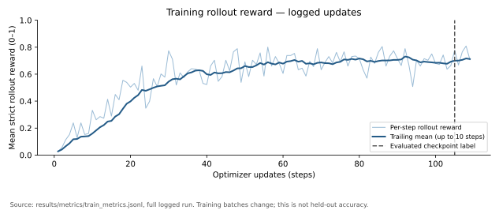
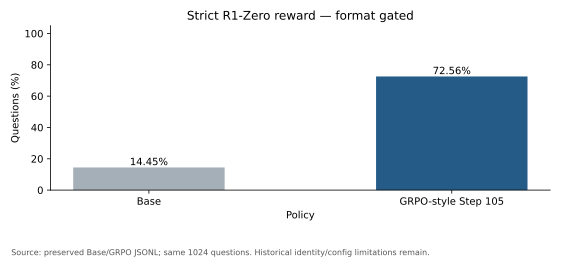
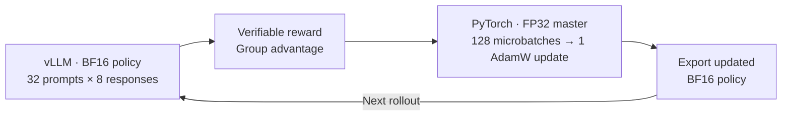
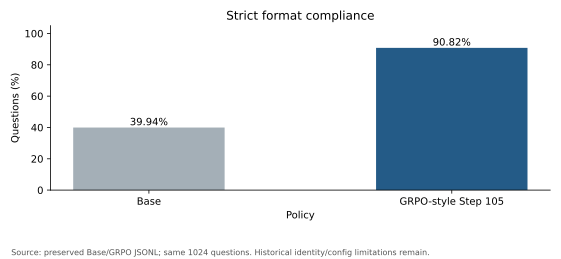
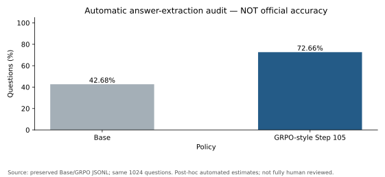

# Single-GPU GRPO-Style Post-Training for Mathematical Reasoning

**An end-to-end mathematical RL post-training pipeline for Qwen2.5-Math-1.5B on one AMD MI300X.**

Built with **PyTorch + vLLM**, integrating online rollouts, verifiable answer rewards,
group-relative policy gradients, gradient accumulation, policy synchronization and checkpoint recovery.
Developed as an extension of Stanford CS336 Spring 2025 Assignment 5.

[中文说明](README_CN.md) · [Core implementation](src/grpo_posttraining/core.py) · [Training loop](src/grpo_posttraining/trainer.py#L131) · [Evaluation](docs/evaluation.md)

## Key Results

Base and the **Step 105 policy** were evaluated on the same fixed **1024-question MATH Test subset**.

| Metric | Base | RL-trained · Step 105 |
|---|---:|---:|
| **Strict R1-Zero reward** | 14.45% | **72.56%** |
| Output format compliance | 39.94% | **90.82%** |
| Supplementary answer-extraction estimate | 42.68% | 72.66% |

Strict reward improved by **+58.11 percentage points**; it requires both answer correctness and the specified format, so the change includes format learning.
The supplementary **+29.98pp** is an automated diagnostic estimate, not an independently validated mathematical benchmark accuracy.



The logs record **109 optimizer updates**, with the **Step 105 checkpoint** used for evaluation.
Through Step 105, training sampled **26,880 responses**; the curve shows rollout-batch reward and a trailing average, rather than held-out accuracy.



## What I Built

### 1. Online group-relative policy optimization

Each iteration samples **32 MATH prompts × 8 responses**, producing a rollout batch of **256 responses**.
A mathematical answer grader supplies terminal rewards; subtracting the group mean and dividing by the group standard deviation produces signed advantages.
The loss uses only **response-token log probabilities**, normalized by each response's valid length.

The reported objective is **on-policy REINFORCE with a group baseline**; clipped GRPO/PPO was not enabled.
See [advantage computation](src/grpo_posttraining/core.py#L47) and the [policy-gradient microbatch step](src/grpo_posttraining/core.py#L256).

### 2. Single-GPU rollout and training orchestration

A short-lived **vLLM worker** generates from a **BF16 policy export** on the same GPU as the PyTorch trainer.
The controller waits for that worker to exit before running backward with **FP32 master parameters and BF16 autocast**.
It accumulates gradients across **128 microbatches × 2 responses**, then performs **one AdamW update**.
This separates generation and backward execution without dedicating a second GPU to inference.

### 3. Policy synchronization, recovery and evaluation

After an update, the trainer exports the new BF16 policy for the next rollout.
Full checkpoints save the model, optimizer and CPU/GPU RNG state; the resume path restores that state and rebuilds the rollout policy.
The evaluation tooling pairs Base/RL outputs by question, analyzes format bias, and provides a fresh-run entry that binds outputs to model and protocol hashes.

## System Architecture



Generation and backward run sequentially; the training model and optimizer can remain resident during rollout.
[Architecture and module map](docs/architecture.md).

## Technical Implementation

| Component | Reported configuration |
|---|---|
| Initial policy | Qwen2.5-Math-1.5B Base |
| Rollout batch | 32 prompts × group size 8 = 256 responses |
| Training precision | FP32 master parameters + BF16 autocast |
| Gradient accumulation | 128 microbatches × 2 responses |
| Optimization | AdamW, LR `1e-5`, one update per rollout batch |
| State recovery | Full model, optimizer and CPU/GPU RNG checkpoint |

| Code entry | File and function |
|---|---|
| Group advantage | [core.py · run_compute_group_normalized_rewards](src/grpo_posttraining/core.py#L47) |
| Token log probabilities | [core.py · run_get_response_log_probs](src/grpo_posttraining/core.py#L91) |
| Policy gradient / response mask | [core.py · run_grpo_microbatch_train_step](src/grpo_posttraining/core.py#L256) |
| Training loop | [trainer.py · _training_main](src/grpo_posttraining/trainer.py#L131) |
| vLLM rollout | [trainer.py · _rollout_worker](src/grpo_posttraining/trainer.py#L33) |
| Policy export | [trainer.py · _save_policy_for_rollout](src/grpo_posttraining/trainer.py#L87) |
| Checkpoint / restore | [trainer.py · _save_checkpoint](src/grpo_posttraining/trainer.py#L110), [resume branch](src/grpo_posttraining/trainer.py#L237) |
| Independent evaluation | [evaluation.py · run](src/grpo_posttraining/evaluation.py#L34) |

The core also includes [SFT tokenization/masking](src/grpo_posttraining/core.py#L14) and [SFT loss](src/grpo_posttraining/core.py#L242).
The [Chinese algorithm guide](docs/algorithm.md) explains the objective, masking and accumulation with source references.

## Evaluation and Case Studies

Paired strict-reward transitions: **601 wrong → right**, **6 right → wrong**.
The archived evaluator uses a shared prompt and decoding implementation for both models; the preserved rows allow direct question-level comparison.

| Case | Question | Gold | Base | RL | Strict reward, Base → RL |
|---|---|---:|---:|---:|---|
| [193](results/records/grpo.jsonl#L40) | Rectangle: area 180, perimeter 54; find the diagonal squared | 369 | 361 | 369 | 0 → 1 |
| [77](results/records/base.jsonl#L14) | Solve `(2x−1)/(2x+2) = (x−3)/(x−1)` | −7 | −7 | −7 | 0 → 1; Base failed the format gate |
| [3155](results/records/grpo.jsonl#L622) | Sum the smallest and largest prime factors of 10101 | 40 | 40 | 26 | 1 → 0 |

These compare final answers and original scores. [Five complete case studies](results/examples/CASES_CN.md) include numerical gains, correct-but-format-invalid Base answers and an RL failure.

<details>
<summary>Format compliance and supplementary answer-extraction audit</summary>

 

Sources: [preserved response records](results/records/), [recomputed summary](results/metrics/recomputed/summary.json) and [figure source hashes](results/figures/figure_sources.json).

</details>

[Evaluation protocol](docs/evaluation.md) · [中文格式偏差分析](docs/evaluation_cn.md) · [Paired-transition figure](results/figures/error_transition.svg)

## Quick Start

Regenerate reports and plots from the included experiment records:

```sh
python scripts/project.py check-config
python scripts/project.py report --output .local/reports/readme-review-001
python scripts/project.py figures --output .local/figures/readme-review-001
```

Use Python 3.12; plotting requires Matplotlib. Choose a new output directory for each run.
These commands analyze existing records. [Training, new GPU evaluation, full-state resume and CPU test commands](docs/reproducibility.md) are documented separately.

## Reproducibility and Scope

The repository includes records, manifests, source mappings and CPU tests for the core functions and evaluation safeguards.
The evaluated subset has no exact/whitespace-normalized Train overlap and contains six previously used development questions.
[Reproducibility](docs/reproducibility.md), [limitations](docs/limitations.md) and [provenance](docs/provenance.md) document historical identity, environment, checkpoint contents and GPU-validation boundaries.

## Acknowledgements

Built upon Stanford CS336 Spring 2025 A5, Qwen2.5-Math, PyTorch, vLLM, Transformers and the attributed third-party mathematical grader.
Course scaffolding, the grader and pretrained weights retain their original attribution; see [NOTICE](NOTICE.md) and [license notes](LICENSE_NOTES.md).
The project focuses on single-turn mathematical RL post-training; its implemented scope and future extensions are documented in [limitations](docs/limitations.md).
