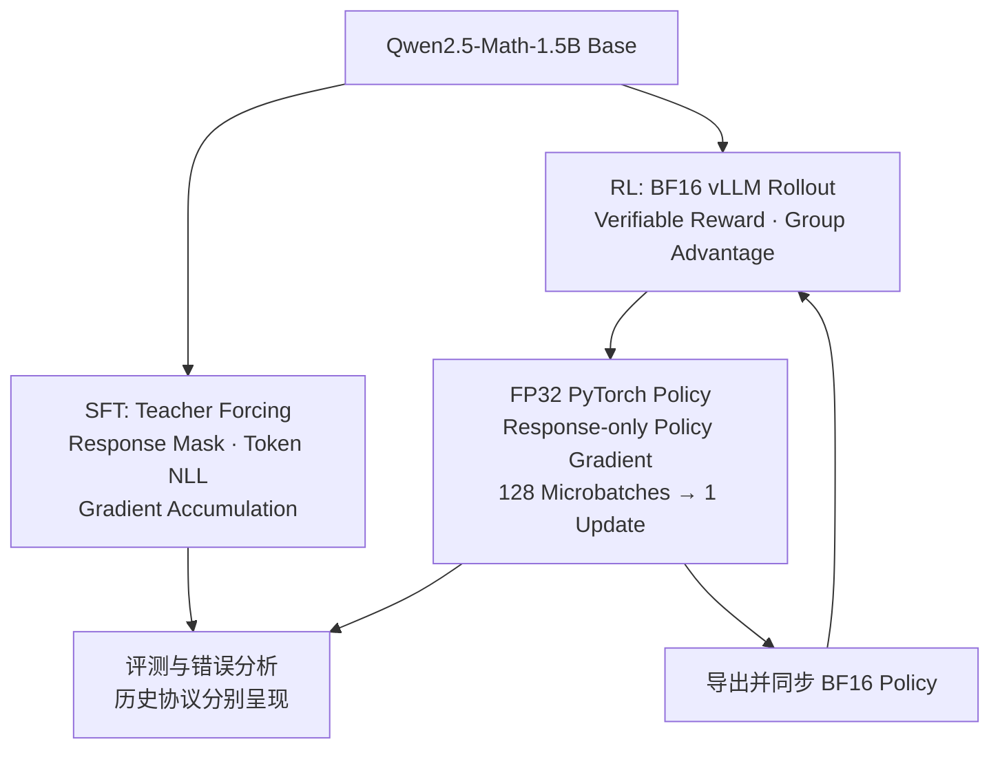

# 单卡 LLM 后训练：SFT 与 Group-Relative Reinforcement Learning

**围绕 Qwen2.5-Math-1.5B，实现 SFT 与数学推理强化学习，并在单张 AMD MI300X 上运行 PyTorch/vLLM 串行训练流水线。**

项目从 Stanford CS336 Spring 2025 A5 扩展而来，覆盖 Teacher Forcing、Response Mask、Token NLL、组内优势、Policy Gradient、混合精度、梯度累积、权重同步与 Checkpoint 恢复。SFT 和 RL 是各自从 **Base** 出发的两条实验分支。

[English](README.md) · [精选原始手写实现](original_implementation/README.md) · [SFT 训练器](src/grpo_posttraining/sft.py) · [RL 训练器](src/grpo_posttraining/trainer.py) · [SFT 实验证据](docs/sft_experiments.md)

## 主要结果

**RL：固定 1024 道 MATH Test，Base 与 Step 105 同题评测。**

| 指标 | Base | RL · Step 105 |
|---|---:|---:|
| Strict R1-Zero Reward | 14.45%（148/1024） | **72.56%（743/1024）** |
| 格式通过率 | 39.94% | **90.82%** |
| 补充答案提取估计 | 42.68% | 72.66% |

严格评分提高 **58.11 个百分点**，其中包含格式学习。最后一行是自动诊断估计，不是正式准确率。同题配对有 **601 道 Wrong → Right、6 道 Right → Wrong**。日志记录 **109 次 optimizer update**；用于评测的是 **Step 105 checkpoint**，此前累计 **26,880 条 rollout responses**。

**SFT：单独的 50 题开发评测，训练数据为 128 条推理轨迹。**

| 指标 | Base | BF16 SFT | FP32 SFT + BF16 Autocast |
|---|---:|---:|---:|
| 严格正确 | 0/50 | 0/50 | **3/50** |
| 格式通过 | 8/50 | 2/50 | 5/50 |
| 达到 1024-token 预算 | 7/50 | 14/50 | 44/50 |

两组均完成 **1 epoch、32 次更新**。FP32 前/后 8 步的 response-token 加权训练 NLL 为 **0.7669 / 0.5965**，来自不同训练 batch。这组实验暴露了长度与终止控制问题；SFT 和 RL 的评测协议不同，上下两表不作为模型排名。

## 实现内容

### SFT：从训练目标到完整入口

实现 prompt/response tokenization、shifted labels、response-only mask、token log probability 与 SFT backward。正式 [SFT 模块](src/grpo_posttraining/sft.py)接入 DataLoader、单样本 microbatch、4 次梯度累积、AdamW、gradient clipping、BF16/FP32 参数方案、指标记录与 HF 模型/tokenizer 导出。历史目标对 response NLL 求和后按样本平均，日志另记 token-mean NLL。

### GRPO-style RL：可验证奖励驱动的在线更新

每轮 **32 prompts × 8 responses**，数学评分器给出终局奖励，组内减均值并除以标准差得到 advantage。只对 response token 计算策略梯度，按每条 response 的有效长度归一化。实测算法是 **on-policy REINFORCE with group baseline**，没有启用 PPO/GRPO clipping。

### 单 GPU 训练工程

短生命周期 vLLM worker 从 **BF16 策略导出**生成；控制器等待 worker 退出后，使用 **FP32 master policy + BF16 autocast**反向传播。**128 microbatches × 2 responses**完成一次 AdamW update，再导出新权重用于下一轮 rollout。RL 完整 checkpoint 保存 model、optimizer 和 CPU/GPU RNG；SFT 仅导出 model/tokenizer。

## 训练架构



RL 实际从 Base 初始化，**没有接续 SFT checkpoint**。生成与 backward 串行调度，训练模型与 optimizer 可以在 rollout 期间保持驻留。[详细模块图](docs/architecture.md)。

## 实验

### SFT：精度、训练 NLL 与终止问题

128 条公开 R1 衍生 MATH Train 轨迹；LR `1e-5`、seed 42、microbatch 1、accumulation 4、最长 shifted sequence 2048、clip norm 1。FP32 + BF16 autocast 的全程 token 加权训练 NLL 为 **0.6674**，BF16 参数方案为 **0.7866**。FP32 峰值 allocated 显存 **29.25 GiB**，记录的训练窗口合计 **39.88 秒**，不含加载与最终导出。


91/128 条训练 response 长于 1024-token 评测预算，历史监督目标没有 EOS。下一步应受控检验 EOS 与长度策略，当前观察不足以确定因果。[完整配置、指标与评测记录](docs/sft_experiments.md)。

### RL：在线奖励与固定题集评测


曲线覆盖 109 次日志更新；截至评测用 Step 105，前/后 10 个 rollout batch 平均奖励为 **0.1598 / 0.7000**。记录的更新窗口合计 **11,505.78 秒**，不含模型加载、权重导出、checkpoint 保存和中断。


来源：[RL 汇总](results/metrics/recomputed/summary.json)、[训练日志](results/metrics/train_metrics.jsonl)、[同题生成记录](results/records/)。

<details>
<summary>SFT 独立评测、RL 格式通过率与补充答案提取</summary>


 

图表条件与数据哈希：[SFT](results/sft/figures/figure_sources.json)、[RL](results/figures/figure_sources.json)。

</details>

## 技术实现

| 组件 | SFT | 本次 RL |
|---|---|---|
| 训练信号 | 已有示范 response token | 可验证终局奖励 |
| Loss | Response-summed NLL，按样本均值 | Group advantage × response-mean log probability |
| Optimizer | AdamW，LR `1e-5`，betas `(0.9,0.999)` | AdamW，LR `1e-5`，betas `(0.9,0.95)` |
| 梯度累积 | 4 × 1 sample | 128 × 2 responses |
| 精度 | BF16 参数或 FP32 + BF16 autocast | FP32 + BF16 autocast，BF16 rollout export |
| Checkpoint | HF model/tokenizer 导出 | 完整 model/optimizer/RNG |

共享 tokenization、log probability、masking 和 backward 基础组件，保留不同的 loss normalization。[SFT 公式与实现](docs/sft.md) · [RL 目标与梯度](docs/algorithm.md)。

## 代码导航

| 入口 | 展示的技术能力 |
|---|---|
| [sft.py](src/grpo_posttraining/sft.py) | 数据校验、Teacher Forcing、梯度累积与正式训练入口 |
| [core.py](src/grpo_posttraining/core.py) | SFT/RL 共享核心、组内优势与策略梯度 |
| [trainer.py](src/grpo_posttraining/trainer.py) | 单卡调度、vLLM worker、权重导出与恢复 |
| [evaluation.py](src/grpo_posttraining/evaluation.py) | 模型/协议哈希绑定、独立输出目录与配对评测 |
| [sft_analysis.py](src/grpo_posttraining/sft_analysis.py) / [analysis.py](src/grpo_posttraining/analysis.py) | CPU 可复核统计与有来源的图表 |
| [原始 adapters](original_implementation/adapters.py)、[原始 SFT trainer](original_implementation/sft/train_sft_a5_fp32.py) | 原始核心填充实现与实际训练过程 |
| [tests](tests/) / [选材来源](provenance/original_selection.json) | CPU 不变量与原始代码到正式代码的映射 |

## 快速开始

使用现有 Python 3.12 环境；测试需 PyTorch/pytest，绘图需 Matplotlib。下列命令不加载模型：

```sh
python -m pytest -q --basetemp=.local/pytest-temp -p no:cacheprovider
python scripts/project.py sft-report --output .local/reports/sft-001
python scripts/project.py sft-figures --output .local/figures/sft-001
python scripts/project.py report --output .local/reports/rl-001
python scripts/project.py figures --output .local/figures/rl-001
python scripts/project.py check-config
```

每次选择新输出目录。当前 **49 项 CPU 测试通过**，使用小型张量/模型，不下载模型 fixture。
未来在已有 GPU 环境与本地数据下运行 SFT：

```sh
python scripts/project.py sft-train --model /local/base --data /local/sft_128.jsonl --run-name sft-fp32-001 --precision fp32_bf16_autocast --execute-training
```

GPU 操作需显式开关，本次整理没有执行。[RL 训练、resume、评测及环境边界](docs/reproducibility.md)。

## 评测与错误分析

Strict Reward 同时要求规定标签和答案匹配，数学答案正确但格式不符也可得 0。补充答案提取与严格分数分开保存。

RL 同题案例：[193](results/records/grpo.jsonl#L40) 将矩形对角线平方从 361 改为正确的 369；[77](results/records/base.jsonl#L14) 中 Base 已答对 −7，但格式失败；[3155](results/records/grpo.jsonl#L622) 从正确的 40 退化为 26。[五个完整案例](results/examples/CASES_CN.md) · [评测协议](docs/evaluation.md)。

## 复现边界与后续工作

历史 JSONL、指标与源码映射可复核；正式 SFT 重整入口经过 CPU 测试，历史训练由原始脚本执行。SFT 备份不含权重；本地 Step 105 RL 归档不含 optimizer/RNG。历史 Base 和评测权重缺少当时的哈希。

1024 题无训练集完全相同/空白归一化重叠，但包含六道早期开发题。SFT 50 题采样评测与 RL 1024 题贪心评测分别呈现。项目定位为 **A5 核心实现 + 精选后训练实验**，下一步是终止控制、独立确认集与算法消融。[局限](docs/limitations.md) · [SFT 实验证据](docs/sft_experiments.md)。

## 致谢

Stanford CS336 Spring 2025 A5 提供课程框架和 adapters 函数接口；具体填充实现和单 GPU 流水线来自项目工作。第三方数学评分器、Qwen 预训练模型、MATH 数据、PyTorch、Transformers、vLLM 和 ROCm 保留原归属。[NOTICE](NOTICE.md) · [许可证](LICENSE_NOTES.md) · [来源说明](docs/provenance.md)。
