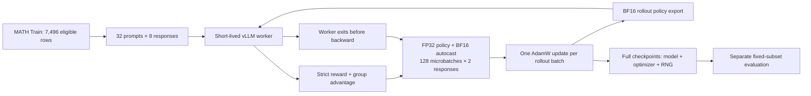

# 单卡大模型强化学习训练与数学推理评测系统

[English](README.md) · [算法说明](docs/algorithm.md) · [评测审计](docs/evaluation_cn.md) · [复现入口](docs/reproducibility.md)

基于 Stanford CS336 Spring 2025 A5 扩展的数学推理后训练项目：使用 Qwen2.5-Math-1.5B，
将 PyTorch 训练与 vLLM Rollout 放在同一张 GPU 上分阶段执行。历史硬件按实验记录为 AMD MI300X；本次没有重新测量 GPU。

## 已完成的工程工作

- SFT 基础：Tokenization、Response Mask、Log Probabilities、SFT Loss。
- RL：组内标准化 Advantage、响应长度归一化 Policy Gradient、128次梯度累计、每批一次更新。
- 单卡运行：FP32 主参数、BF16 推理副本、磁盘权重同步，以及完整 checkpoint 的保存/恢复代码。
- 评测：固定题集、严格格式评分、补充答案提取诊断、数据隔离检查和逐题证据。

定位是 **A5 核心实现与选定实验**。实际训练是带 Group Baseline 的 REINFORCE，属于 GRPO 风格；
没有启用 PPO/GRPO clipping，也没有实现 Tool-Using Agent RL。

## 关键结果

| Metric on the same 1024 questions | Base | GRPO-style Step 105 |
|---|---:|---:|
| Strict R1-Zero reward (format gated) | 148/1024 (14.45%) | 743/1024 (72.56%) |
| Format compliance | 39.94% | 90.82% |
| Supplementary automatic extraction estimate — **not official accuracy** | 42.68% | 72.66% |

严格 Reward 提升 **58.11 个百分点**，包含格式学习，不能等同纯数学推理能力提升。
补充提取估计差值为 29.98 个百分点；它没有经过完整人工复核，不是正式数学准确率。

日志记录到 **Step 109**，最后可确认的完整 checkpoint 指针和评测标签是 **Step 105**。
前 105 步共采样 **26,880 条训练响应**；不能混淆日志终点与评测模型。


浅线为每步训练批次的平均 Reward，深线为最多10步的尾随平均；这不是固定验证集曲线。

 

 

图表均由实际 JSONL 重新计算，来源与哈希见 [figure_sources.json](results/figures/figure_sources.json)。

## 架构



Execution is serialized; the training model/optimizer remain resident during rollout.
The provided local Step 105 archive contains **model files only**, not a full resume checkpoint.

“串行”指执行阶段；训练模型及 optimizer 仍可能在 Rollout 时驻留显存，不能声称完全没有显存重叠。

## 算法：SFT 与 RL 有什么不同？

SFT 使用给定的参考响应，最小化参考 Token 的负对数概率；RL 从当前策略采样响应，
根据结果奖励调整被采样动作的概率。正 Advantage 提高对应响应 Token 的概率，负 Advantage 降低它。

本项目从每组8条响应的奖励中减去组均值，并除以组标准差加一个很小的稳定项。
只对 Response Mask 为真的位置计算损失，先按每条响应的有效长度归一化，再对 batch 求平均。
256条响应由32道题产生，拆为128个大小为2的 microbatch；累积梯度后仅更新一次，
下一批再使用新策略生成。它没有使用旧策略概率比值的 clipping。

公式、维度和真实函数入口见 [docs/algorithm.md](docs/algorithm.md)。训练 Reward 上升不等于泛化提升，
尤其是在训练题目、响应长度和格式随策略变化时。

## CPU 快速开始

```sh
python scripts/project.py check-config
python scripts/project.py doctor
python scripts/project.py report --output .local/reports/recomputed-001
python scripts/project.py figures --output .local/figures/recomputed-001
python -m pytest -q --basetemp=.local/pytest-temp -p no:cacheprovider
```

Use Python 3.12. Reporting uses the standard library; plots need Matplotlib; core
tests need an existing CPU PyTorch installation and pytest. Data isolation checks
add PyArrow. See [dependencies and exact commands](docs/reproducibility.md).
No command above loads a pretrained model or probes a GPU.

上述命令不会加载预训练模型或探测 GPU。完整路径、依赖和输出说明见 [复现文档](docs/reproducibility.md)。
有模型和 ROCm 环境时，才可显式开启新的 GPU 评测/训练；本次没有执行它们。

## 评测与错误

严格结果：601题由错到对、6题由对到错。
其中427个收益案例的 Base 原先格式无效，不能把所有收益归为推理进步。

[五个真实案例](results/examples/CASES_CN.md)包含两道数值错误到正确、两道 Base 明确答案正确但格式失败，以及一道 GRPO 仍答错的题。
展示只使用最终答案区域，不用推理开头证明整段推理正确。

数据有7,500道 Train、5,000道 Test；当前1,024题与 Train 无完全/空白归一化重合。
全量 Test 存在一道空白归一化重复题。当前子集有6道历史开发题，因此不能称为完全未查看的最终确认集。

## 复现边界

当前模型包哈希不能认证历史评测时的权重；本地 Step105 包也没有 optimizer/RNG 状态。
原始依赖声明与实际 ROCm 环境有差异，不能直接在 Windows 安装课程依赖就称为训练复现。
源码已整理、CPU 测试和图表已验证；新的 GPU 运行路径仍待真实环境验收。

详见 [局限](docs/limitations.md)、[评测说明](docs/evaluation_cn.md)、[来源](docs/provenance.md)。

## 致谢

保留 Stanford CS336、第三方数学评分器、Qwen 和依赖项目的归属。
课程模板、评分器和模型权重不属于个人原创，见 [NOTICE.md](NOTICE.md) 与 [LICENSE_NOTES.md](LICENSE_NOTES.md)。
