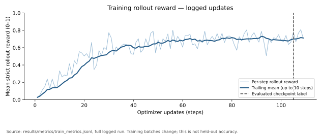
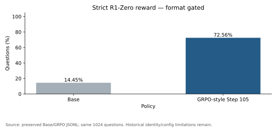
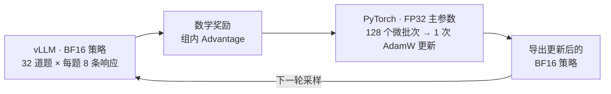
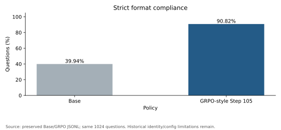
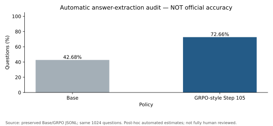

# 单卡大模型强化学习训练与数学推理评测系统

**在单张 AMD MI300X 上，为 Qwen2.5-Math-1.5B 打通在线采样、数学奖励、策略优化与评测。**

使用 **PyTorch + vLLM** 串联 Rollout、组相对优势、响应级策略梯度、梯度累积、权重同步和断点恢复。
项目源于 Stanford CS336 Spring 2025 Assignment 5 的数学后训练扩展。

[English](README.md) · [核心算法](src/grpo_posttraining/core.py) · [训练主循环](src/grpo_posttraining/trainer.py#L131) · [评测说明](docs/evaluation_cn.md)

## 关键结果

在相同的 **1024 道 MATH Test 题**上，对比 Base 与 **Step 105 的 RL 模型**：

| 指标 | Base | RL 模型 · Step 105 |
|---|---:|---:|
| **严格 R1-Zero Reward** | 14.45% | **72.56%** |
| 输出格式合格率 | 39.94% | **90.82%** |
| 补充答案提取估计 | 42.68% | 72.66% |

严格 Reward 提升 **58.11 个百分点**，同时包含答案正确性与格式学习的收益。
补充提取差值为 **29.98 个百分点**，属于自动诊断估计，不是经过独立验证的正式数学准确率。



训练日志记录 **109 次 optimizer update**，用于评测的模型为 **Step 105**；前 105 步共采样 **26,880 条训练响应**。
曲线展示每步训练批次的平均 Reward 及尾随平均，用于观察训练过程。



## 核心系统实现

### 1. 在线采样与组相对策略优化

每轮从 MATH Train 采样 **32 道题，每题生成 8 条响应**，组成 **256 条响应的 Rollout Batch**。
数学评分器给出终局奖励，再在同题的响应组内减去平均奖励、除以组标准差，得到可正可负的 Advantage。
训练只对 **Response Token** 计算 Policy Gradient，并按各响应的有效长度归一化。

实际目标是带组相对优势的 **on-policy REINFORCE with baseline**，本次训练未启用 GRPO/PPO clipping。
对应 [Advantage 计算](src/grpo_posttraining/core.py#L47) 与 [Policy Gradient 微批次训练](src/grpo_posttraining/core.py#L256)。

### 2. 单卡上的推理与反向传播调度

同一张 GPU 分阶段承担两项任务：**vLLM 使用 BF16 策略副本采样，PyTorch 使用 FP32 主参数和 BF16 Autocast 训练**。
控制器等待 Rollout 进程退出后再开始反向传播，将 256 条响应拆成 **128 个、每个 2 条响应的 microbatch**。
累积全部梯度后执行 **一次 AdamW 更新**，让采样批次与优化更新保持清晰的对应关系。

这种调度把推理和训练放在同一设备上执行，省去了独立的推理 GPU。

### 3. 权重同步、断点恢复与评测管理

每次参数更新后，将新策略导出为 BF16 权重，供下一轮 vLLM 采样使用。
完整 checkpoint 保存模型、optimizer 和 CPU/GPU RNG 状态；恢复分支重建训练状态与采样策略。
评测按同题逐条对比 Base/RL 输出；新的独立评测入口还将结果绑定到模型、Tokenizer、Prompt 和题集哈希，防止缓存结果被错误复用。

## 系统架构



串行的是采样与反向传播的执行阶段，训练模型和 optimizer 仍可在采样期间驻留显存。
[模块划分与调度说明](docs/architecture.md)。

## 技术实现与代码入口

| 组件 | 本次实验配置 |
|---|---|
| 初始策略 | Qwen2.5-Math-1.5B Base |
| 每轮采样 | 32 道题 × group size 8 = 256 条响应 |
| 训练精度 | FP32 主参数 + BF16 Autocast |
| 梯度累积 | 128 个 microbatch，每个 2 条响应 |
| 参数更新 | AdamW，学习率 `1e-5`，每个 Rollout Batch 更新一次 |
| 状态恢复 | 完整模型、optimizer、CPU/GPU RNG checkpoint |

| 功能 | 对应文件与函数 |
|---|---|
| 组相对优势 | [core.py · run_compute_group_normalized_rewards](src/grpo_posttraining/core.py#L47) |
| Token Log Probabilities | [core.py · run_get_response_log_probs](src/grpo_posttraining/core.py#L91) |
| Policy Gradient 与 Response Mask | [core.py · run_grpo_microbatch_train_step](src/grpo_posttraining/core.py#L256) |
| 训练循环 | [trainer.py · _training_main](src/grpo_posttraining/trainer.py#L131) |
| vLLM Rollout | [trainer.py · _rollout_worker](src/grpo_posttraining/trainer.py#L33) |
| 策略权重导出 | [trainer.py · _save_policy_for_rollout](src/grpo_posttraining/trainer.py#L87) |
| Checkpoint 与恢复 | [trainer.py · _save_checkpoint](src/grpo_posttraining/trainer.py#L110)、[恢复分支](src/grpo_posttraining/trainer.py#L237) |
| 独立评测 | [evaluation.py · run](src/grpo_posttraining/evaluation.py#L34) |

SFT 基础实现包括 [Tokenization / Response Mask](src/grpo_posttraining/core.py#L14) 和 [SFT Loss](src/grpo_posttraining/core.py#L242)。
算法公式、维度和归一化方式见 [中文算法说明](docs/algorithm.md)。

## 评测与真实案例

同题严格 Reward 对比中，**601 题由错到对，6 题由对到错**。
历史评测器为两模型使用同一 Prompt 与解码实现，保存的逐题记录支持进一步拆解数值错误、格式问题与最终答案提取差异。

| 案例 | 题目摘要 | 标准答案 | Base | RL | 严格 Reward：Base → RL |
|---|---|---:|---:|---:|---|
| [193](results/records/grpo.jsonl#L40) | 矩形面积 180、周长 54，求对角线长度的平方 | 369 | 361 | 369 | 0 → 1 |
| [77](results/records/base.jsonl#L14) | 求 `(2x−1)/(2x+2) = (x−3)/(x−1)` 中的 x | −7 | −7 | −7 | 0 → 1；Base 格式失败 |
| [3155](results/records/grpo.jsonl#L622) | 求 10101 的最小与最大质因数之和 | 40 | 40 | 26 | 1 → 0 |

表中对照最终答案和原始评分。[五个完整案例](results/examples/CASES_CN.md)还包含更多数值改善、Base 答案正确但格式失败及 RL 仍出错的例子。

<details>
<summary>展开：格式合格率与补充答案提取诊断</summary>

 

数据来源：[原始评测记录](results/records/)、[重算汇总](results/metrics/recomputed/summary.json)与[图表来源哈希](results/figures/figure_sources.json)。

</details>

[中文格式偏差分析](docs/evaluation_cn.md) · [完整评测协议](docs/evaluation.md) · [同题错误转移图](results/figures/error_transition.svg)

## 快速开始

从仓库根目录重算已有实验记录的报告和图表：

```sh
python scripts/project.py check-config
python scripts/project.py report --output .local/reports/readme-review-001
python scripts/project.py figures --output .local/figures/readme-review-001
```

建议使用 Python 3.12；绘图需要 Matplotlib，每次重算使用新的输出目录。
这些命令只分析已有记录；训练、新的 GPU 评测、完整 checkpoint 恢复以及 CPU 测试命令见 [复现指南](docs/reproducibility.md)。

## 复现与实验范围

仓库提供逐题记录、数据哈希、源码映射和核心函数及评测保护机制的 CPU 测试。
当前评测子集与 Train 无完全或空白归一化重合，包含 6 道历史开发题。
模型身份追溯、环境差异、恢复所需文件与 GPU 验收范围，详见 [复现指南](docs/reproducibility.md)、[实验局限](docs/limitations.md)和[来源记录](docs/provenance.md)。

## 致谢

基于 Stanford CS336 Spring 2025 A5、Qwen2.5-Math、PyTorch、vLLM、Transformers 及注明来源的第三方数学评分器。
课程模板、评分器和预训练权重保留原始归属，见 [NOTICE](NOTICE.md) 与 [许可说明](LICENSE_NOTES.md)。
项目聚焦单轮数学推理强化学习；已实现范围与后续扩展边界见 [实验局限](docs/limitations.md)。
