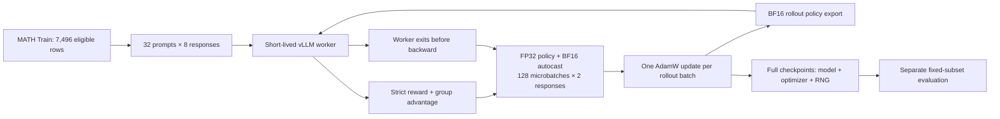

# Architecture and module map

Execution is serialized; the training model/optimizer remain resident during rollout.
The provided local Step 105 archive contains **model files only**, not a full resume checkpoint.

| Concern | Maintained code | Evidence / behavior |
|---|---|---|
| SFT and RL primitives | `src/grpo_posttraining/core.py` | 11 function bodies preserved; AST and segment-hash checks |
| GPU orchestration | `src/grpo_posttraining/trainer.py` | Serialized worker/backward, FP32 master, BF16 export |
| Scoring | `src/grpo_posttraining/grader.py` | Byte-identical archived third-party grader |
| New evaluation | `src/grpo_posttraining/evaluation.py` | Fresh directories, hashes, shared tokenizer, raw IDs/finish metadata |
| Historical analysis | `src/grpo_posttraining/analysis.py` | Validates pairing and original format gates; no generation |
| CLI / opt-in | `scripts/project.py`, `src/grpo_posttraining/cli.py` | Explicit GPU/training flags, local-only inputs |
| Byte identity | `src/grpo_posttraining/artifacts.py` | Model inventories and append-only JSON output |

CPU command execution imports no pretrained model. Core tests use toy CPU tensors/models.
New training starts from the supplied Base; original configuration also points to Base,
not the earlier SFT checkpoint. The maintained checkpoint writer preserves all full
checkpoints, so storage must be budgeted; disposable rollout-policy exports still rotate.
Recovery retains interrupted rollout files and a pre-prune metrics copy under `recovery/`.
See `provenance/trainer_changes.diff`; no new GPU behavior is claimed tested.
