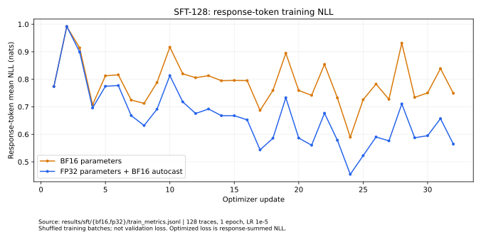
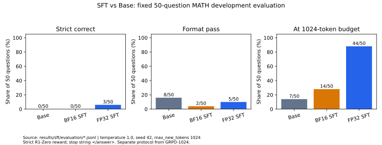

# SFT-128: measured experiments / 实测结果

来源为 `a5_experiment_records_20261106.tar.gz`，SHA256 见
[选材清单](../provenance/original_selection.json)。两组 32 行训练日志和三组各 50 行评测记录
按原始字节公开；配置仅替换本地路径。所有下表由
[sft_analysis.py](../src/grpo_posttraining/sft_analysis.py)重新计算，完整精度见
[summary.json](../results/sft/recomputed/summary.json)。

## Setup and completion evidence

模型配置指向 Qwen2.5-Math-1.5B Base；两组均使用同一份 128 条公开 R1 衍生 MATH Train
推理轨迹。这是替代数据，不是 Stanford 官方 SFT 训练集；归档不足以认证上游版本和许可链，
本仓库仅发布数据哈希、逐条长度与标签统计，不重新分发原始训练轨迹。
历史 Base 路径是可变 snapshot，缺少历史权重哈希，当前文件哈希不能补证历史身份。

每组 1 epoch，32 optimizer updates，microbatch 1，累积 4，LR `1e-5`，seed 42，
最长 shifted sequence 2048，AdamW，clip 1.0；无新增 EOS、无截断。
两组日志每步的 input/response token 计数一致，各处理 173,242 input positions、155,986 response targets。
备份有保存后的模型 config、generation config、tokenizer 和指标，**没有 SFT 权重或 optimizer 状态**。
因此可核查训练结束与评测输出，但不能仅凭此备份重新加载 SFT checkpoint。

## Training measurements

| Metric | BF16 parameters | FP32 parameters + BF16 autocast |
|---|---:|---:|
| Response-token weighted NLL, all updates | 0.786622 | 0.667402 |
| First 8 updates, token-weighted NLL | 0.799051 | 0.766889 |
| Last 8 updates, token-weighted NLL | 0.772647 | 0.596547 |
| Sum of recorded update windows (s) | 35.8011 | 39.8793 |
| Input positions / recorded second | 4,839.02 | 4,344.16 |
| Peak allocated memory (GiB) | 14.5580 | 29.2534 |
| Peak reserved memory (GiB) | 22.9023 | 45.9844 |
| Pre-clip gradient norm range | 1,480–2,672 | 1,085.24–2,662.58 |
| Updates with norm > 1 | 32/32 | 32/32 |

每步计时包含同步训练窗口，不含初始加载、最终保存等，不能作为端到端耗时。
显存值为日志中的 PyTorch allocated/reserved，不是设备总使用量。
Token NLL 来自不同 shuffled training batches，不代表固定验证集能力提升；
FP32 参数训练的下降与较低梯度范数是观察，不是精度因果结论。
两组所有更新均触发 clipping，记录的 norm 是裁剪前值。

## Fixed 50-question development evaluation

| Metric | Base | BF16 SFT | FP32 SFT |
|---|---:|---:|---:|
| Strict R1-Zero correct | 0/50 (0%) | 0/50 (0%) | 3/50 (6%) |
| Format pass | 8/50 (16%) | 2/50 (4%) | 5/50 (10%) |
| Generated tokens >= 1024 | 7/50 (14%) | 14/50 (28%) | 44/50 (88%) |
| Mean generated tokens | 382.48 | 659.00 | 1,002.36 |

三模型 `dataset_index`、题目、gold、记录顺序完全配对，原严格评分保持不变。
参数及停止协议见 [SFT 实现说明](sft.md)。这些 50 题已用于开发，不是独立确认集；
与 RL 的 1024 题、temperature 0、BF16 vLLM 协议分开报告，不作跨表模型排名。

## Main finding and next experiment

128 条 response 平均 1,218.64 tokens，91 条长于评测的 1024-token 预算，
全部含完整结束标签，EOS 训练目标为 0。FP32 生成更长且常达预算，
与长度分布、终止监督不足相容；当前记录没有隔离其因果效应。
下一步优先固定同 128 条样本、初始化、seed 和 optimizer，只改变 EOS 监督；
官方 stop string 与独立 EOS 诊断分开，原 50 题只用于开发，另留确认集。
这次整理未实现新的 EOS 训练方案，也没有启动该实验。

## Evidence navigation

- [BF16 metrics](../results/sft/bf16/train_metrics.jsonl#L1)、[FP32 metrics](../results/sft/fp32/train_metrics.jsonl#L1)：每组第 1–32 行对应更新 1–32。
- [BF16 config](../results/sft/bf16/run_config.sanitized.json)、[FP32 config](../results/sft/fp32/run_config.sanitized.json)。
- [Checkpoint metadata](../results/sft/fp32/checkpoint_metadata.json)：保存配置、tokenizer 哈希与归档缺失项。
- [Base](../results/sft/evaluation/base.jsonl)、[BF16](../results/sft/evaluation/bf16.jsonl)、[FP32](../results/sft/evaluation/fp32.jsonl)：各 50 行模型生成记录。
- [Training data statistics](../results/sft/training_data_statistics.json)、[figure source hashes](../results/sft/figures/figure_sources.json)。
